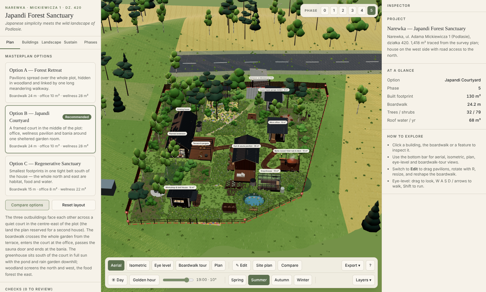
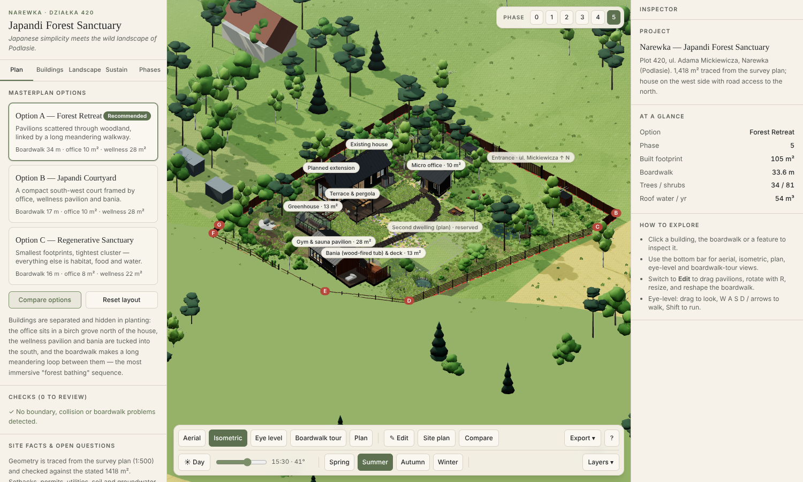
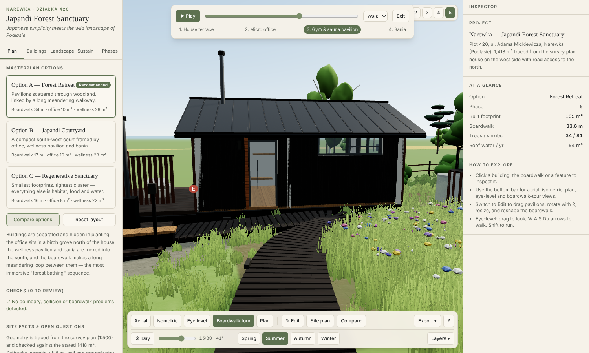
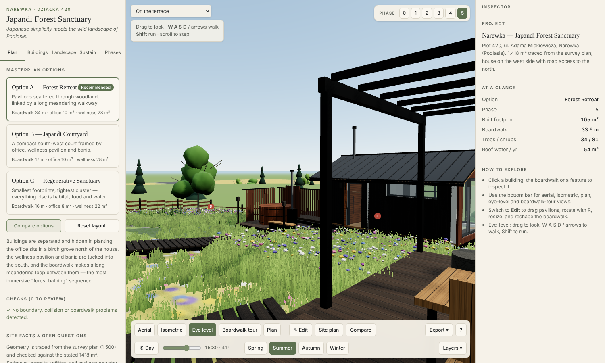
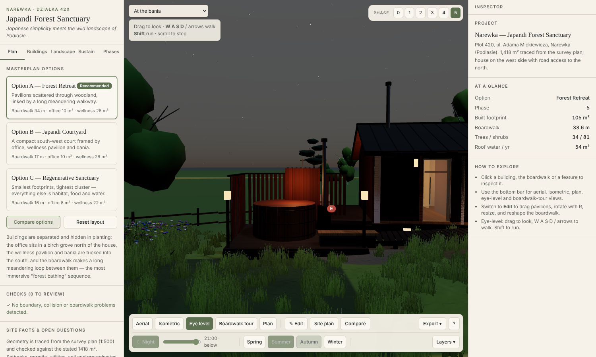

# Narewka — Japandi Forest Sanctuary

An interactive, browser-based 3D masterplan of a private property in **Narewka, Podlasie** (ul. Adama Mickiewicza 1, działka ewid. nr 420). It is a working architectural-visualisation and planning tool, not a render: you can orbit, walk the site, switch seasons and day/night, step through the project phases, move proposed buildings, reshape the boardwalk, and read live sustainability figures that are computed from the model.

> *Japanese simplicity meets the wild landscape of Podlasie.*



| Isometric | Boardwalk tour |
|---|---|
|  |  |
| **Eye level, terrace** | **Evening at the bania** |
|  |  |

Interior: [living + loft](docs/screenshots/s11-interior-living-loft.png) · [kitchen & stair](docs/screenshots/s12-interior-kitchen-stair.png) · [sleeping loft](docs/screenshots/s13-interior-sleeping-loft.png)

More: [plan](docs/screenshots/s03-plan.png) · [night](docs/screenshots/s06-night.png) · [winter](docs/screenshots/s07-winter.png) · [autumn](docs/screenshots/s08-autumn-eye-level.png) · [annotated site plan](docs/screenshots/s09-site-plan.png)

---

## Open it without installing anything

Download **`standalone/narewka-japandi-sanctuary.html`** (one self-contained file, ~1.7 MB) and double-click it — it opens in Chrome / Edge / Firefox. No Node, no install, no internet needed. Regenerate it with `npm run build:single`.

## Run it (development)

```bash
npm install
npm run dev          # http://localhost:5173
npm run build        # type-check + production build into dist/
npm run preview      # serve the production build
```

Node 20+ recommended. No network access is needed at runtime — all textures are generated procedurally in the browser and lighting uses a local environment, so there are no external asset downloads.

Verification scripts (run with `tsx`, no browser needed):

```bash
npm run check:layouts   # boundary / collision / boardwalk checks for options A, B, C
npm run check:metrics   # land balance, planting, rainwater, greenhouse sun for each option
npm run check:compare   # weighted option scoring used by the Compare panel
```

## What is in the app

| Area | What it does |
|---|---|
| **Left sidebar** | *Plan* (3 options, checks, open questions) · *Buildings* · *Landscape* (layers, optional features, planting zones, settings) · *Sustain* (dashboard) · *Phases* |
| **3D viewport** | Aerial, Isometric (orthographic), Eye level (walk), Boardwalk tour, Plan (orthographic, north-up). Click any object to inspect it. |
| **Right inspector** | Description, materials, notes, flags, position / rotation / size controls, boardwalk waypoints |
| **Bottom toolbar** | Camera modes · Edit · Site plan · Compare · Export (screenshot, 2×, save/load JSON) · Day/Night + solar-time slider · Seasons · Layers |
| **Top-right** | Phase strip 0–5 (cumulative) |

### Controls

* **Orbit** left-drag · **pan** right-drag · **zoom** wheel. In *Plan* view the left button pans.
* **Eye level**: drag to look, `W A S D` / arrows to walk, `Shift` to run, wheel to step. A viewpoint selector jumps to the terrace, gate, office, gym/sauna, bania, greenhouse, meadow and food forest.
* **Boardwalk tour**: ▶ plays House → Office → Gym & Sauna → Bania and pauses at each pavilion; the slider scrubs; speed is selectable.
* **Edit mode** (✎): drag a pavilion or optional feature on the ground; `R` rotates 15° (`Shift+R` the other way); `Alt+arrows` nudge; `Esc` deselects. Select the boardwalk to get draggable waypoint handles, and use *+ Waypoint / Remove* in the inspector. Sliders resize within limits. Objects can never be dropped outside the property boundary; collisions, setback warnings and boardwalk conflicts are flagged live (red/amber outlines + the *Checks* list). The existing house, extension and terrace are fixed.
* **Layers**: vegetation, boardwalk, fences, dimensions, name tags, utility routes, open roofs (interiors), night lights, surroundings.
* **Export**: *Screenshot* (PNG, or 2× resolution) · *Annotated site plan* (SVG or 2× PNG) · *Save / Load configuration* (JSON of the full editable project: option, layout edits, phase, season, time, settings).

## Where the geometry comes from

The official development plan PDF (`Projekt zagospodarowania działki 420`, 1:500, 2025) is the source of truth.

1. The A3 page was rasterised at 200 dpi; the red dashed parcel boundary **A-B-C-D-E-F-G** was extracted by colour threshold and its corners read in pixel space.
2. Pixel → metre scale was **calibrated against the stated area**: at the nominal 1:500 scale the traced polygon measures 1357 m²; scaling by 0.0649 m/px reproduces **1417.9 m²** vs the plan's **1418.00 m²** (a ~2 % scale correction). Edge lengths: AB 39.9 m, BC 4.1 m, CD 32.1 m, DE 12.7 m, EF 21.4 m, FG 2.1 m, GA 37.8 m.
3. From the same raster: both dwelling hatches (≈ 4.2–4.3 × 7.4 m), the existing tin garage `g1` (≈ 3.4 × 4.6 m), the planned water Ø32, sewer Ø160 and electric routes, the waste point, the entrance/hardstand and 17 spot heights (148.6 m at the north-west to 145.4 m at the south). The two floor levels in the plan notes (148.10 / 147.80 m) are used for the houses.
4. Terrain is an interpolation of the spot heights (plane fit + weighted residuals), levelled under the existing house. It is **not** a survey DTM.

Accuracy: boundary corners and footprints ±0.3 m, spot heights ±0.1 m. See [docs/SITE_ANALYSIS.md](docs/SITE_ANALYSIS.md).

The house is reproduced from the supplied renders: black standing-seam pitched roof (~40°), vertical timber cladding (dark long walls, warm gables), dark-framed glazing, sliding door, skylight, wood-stove flue, terrace with black steel pergola, sleeping loft, stair and open living space. **Interior (existing house, whole program inside the 4.2 × 7.4 m body).** Walkable Japandi interior with a sleeping loft (*antresola*): pale-oak floor and whitewashed timber ceiling with tie beams and a track light; loft with low bed, slatted headboard, nightstands and a black-steel slat balustrade; oak stair behind a tall black slat screen (as in the supplied section); bathroom (WC, vanity with round mirror, walk-in shower) and built-in wardrobe under the loft; entrance hall; kitchen along the west wall with open shelves and a sink window; round dining table with paper-lantern pendant by the sliding door; living area with sofa, armchair, rug, wood stove on a slate hearth (flue through the roof), plants and art. Use *Eye level → Inside the house…* (living room, kitchen & stair, sleeping loft) or *Layers → Open roofs* for a cut-away. The layout is a design proposal informed by the supplied plan and section; confirm room sizes on site.

The **existing house** (Phase 0) and **planned extension** (Phase 1: a roofed 2-car garage of ≈ 5.8 × 5.5 m **behind the sleeping-loft end**, on the north side facing the entrance drive) are separate objects; the house is never moved or restyled.

## The three options and the recommendation

The second-dwelling land on the plan is **released** (you confirmed no second house will be built), so all three options use the whole parcel. Every option now also contains a **workshop & tool house** (≈ 10 m², barn doors, workbench, pegboard wall, firewood lean-to), an **open carport / garage shelter** by the entrance gate (≈ 18 m²) and a larger **garden pond** with a timber jetty.

| | A — Forest Retreat | B — Japandi Courtyard | C — Regenerative Sanctuary |
|---|---|---|---|
| Idea | Pavilions spread over the whole plot in woodland, one meandering boardwalk | Office, wellness and bania frame one sheltered court in the centre-east | Smallest footprints in one belt south of the house; north and east left to habitat and food |
| Boardwalk | 24 m | 24 m | 15 m |
| Office / wellness | 10.2 / 27.7 m² | 10.2 / 27.7 m² | 8.1 / 21.6 m² |
| Built footprint | 130 m² | 130 m² | 119 m² |
| Biologically active | 79.4 % | 80.1 % | **82.4 %** |
| Greenhouse sun (Dec / Mar / Jun) | 6.8 / 8.7 / 14.4 h | 6.8 / **10.4** / 14.9 h | 6.8 / 10.3 / **15.3** h |
| Weighted score (brief priorities) | 58 | **74** | 44 |

**Recommended: Option B.** It ranks first with the brief's priorities (74 vs 58 / 44) and with equal weights (70 / 50 / 53); only an ecology-first weighting makes C win (63). The in-app *Compare* panel lets you change the weights. Numbers are model outputs, not measurements. Note that built area (130 m²) is well above the plan's 70 m² — permit route to verify.

## Sustainability dashboard — how the numbers are made

All values come from the model geometry; nothing is typed in.

* **Ground classes** are rasterised on a 0.5 m grid inside the surveyed polygon (buildings, paved, decks/boardwalk, stepping stones, pond, rain garden, beds, each planting zone, retained pasture) and normalised to the polygon area.
* **Built footprint** is analytic (rectangles); **permeable** = plot − built − paved; timber decks and the boardwalk are raised on piles with open joints and are counted as permeable *and* reported separately.
* **Biologically active** = vegetated + pond, shown next to the plan's own figure (88.15 %). The scheme falls below it because pavilions, decks and the boardwalk are additional to the plan — flagged in the UI.
* **Rainwater** = roof plan area (+ overhang) × rainfall × 0.9 runoff × 0.9 first-flush/filter. Rainfall defaults to **600 mm/yr and is an editable placeholder** (use IMGW data for Narewka). Tank storage is counted from the tank features.
* **Planting counts** come from the generated planting scatter; *native share* = native woody plants ÷ all woody plants (cultivars and fruit trees count as non-native).
* **Greenhouse sun** ray-casts hourly sun positions (lat 52.93°, solar time) against the site's buildings and tree crowns (leaf-on/leaf-off); neighbours, terrain and cloud are not modelled.
* **Boardwalk gradient** is measured on the actual elevated deck line (target ≤ 8.3 %).
* **Unknown values are shown as unknown** — soil infiltration, groundwater, soil pH, existing flora, carbon/energy performance and garden water demand.

## Planting & biodiversity, phasing, assumptions

* [docs/PLANTING_STRATEGY.md](docs/PLANTING_STRATEGY.md) — zones, species palette (native vs cultivar), flowering sequence, habitats, water and soil strategy.
* [docs/PHASING.md](docs/PHASING.md) — the six project phases and what appears in each.
* [docs/ASSUMPTIONS.md](docs/ASSUMPTIONS.md) — everything that was assumed, and everything that **must be verified** (setbacks, permits, built-area limit, utilities, soil, fire safety, north orientation). The same list is in the app under *Verification items*.

## Rendering notes

* Built with React 19, TypeScript, Three.js, React Three Fiber, Drei, Zustand, Tailwind CSS 4 and Vite.
* Buildings are modelled procedurally with real wall openings, framed glazing, roofs with standing seams, piles, interiors and details — not placeholder boxes. Timber, roofing and stone textures (colour + bump) are generated on a canvas at startup.
* Plants are instanced (9 archetypes with hundreds of instances in a handful of draw calls; grass tufts with a wind shader). The *Render quality → High* setting adds ambient occlusion, bloom and a 4k ground map. Level of detail is handled through instancing, distance fog and shared geometry rather than separate LOD meshes — a glTF plant library with true LODs is the natural next upgrade.
* Seasons change foliage colour and leaf drop, meadow flowering, snow on the ground/roofs and sun path; day/night and the solar-time slider move the sun and switch on lamps, windows and fire.

## Project layout

```
src/
  data/       site.ts (PDF-derived geometry, utilities, verification items), layouts.ts (options A/B/C, phases),
              species.ts, catalog.ts (inspector texts)
  lib/        geometry.ts (polygon, terrain, boardwalk), ground.ts (classification), vegetation.ts (scatter),
              analysis.ts (metrics, rain, solar), solar.ts, validate.ts (checks), compare.ts (scoring)
  scene/      Terrain, House, Pavilions, Features, Boardwalk, Fence, Vegetation, Lighting, CameraRig, Editing …
  ui/         Sidebar, Inspector, Toolbar, Dashboard, SitePlan (SVG), Panels (compare / strategy / verify / help)
  store.ts    Zustand state (option, layout edits, phase, season, camera, layers, settings, JSON import/export)
scripts/      Node verification scripts
docs/         Analysis, planting strategy, phasing, assumptions, screenshots
```

## Limitations & next steps

* Positions of a few small items (stone path, garden features) are design proposals, not survey data; buildings are concept-level architecture, not construction drawings.
* The neighbouring buildings are schematic; the road and fields are painted from the survey base map.
* Vegetation is procedural and stylised. Next steps: glTF plant models with LODs, a drone/DTM terrain import, soil and percolation data, structural/MEP design for the pavilions, an IMGW rainfall import, shadow-casting from neighbouring plots, and a real-time "years of growth" animation.
* The left/right panels are designed for a desktop viewport (≥ 1280 px).
